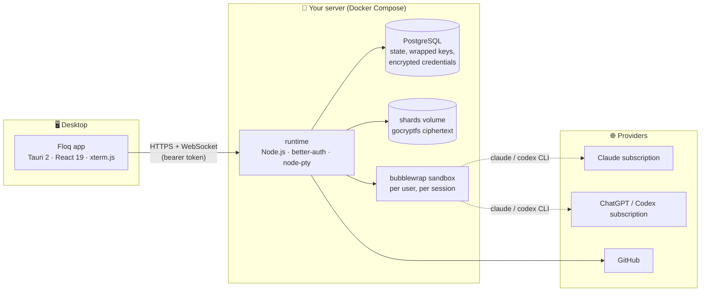

<div align="center">

<!-- TODO(branding): banner image, e.g. .github/assets/banner-dark.svg and banner-light.svg. Not created yet; branding is undecided. -->

<h1>Floq</h1>

<h3>A desktop workspace for running Claude Code and Codex agents on a server you host.</h3>

<p>
Claude Code and Codex in cloud terminals · Per-user encrypted home · Sleep and resume<br/>
<b>Built for one owner, self-hosted, using your own Claude and ChatGPT subscriptions.</b>
</p>

<p>
  
  
  
  
  
  
  
</p>

<p>
  <a href="#-the-product">Product</a> ·
  <a href="#-architecture">Architecture</a> ·
  <a href="#-security-model">Security</a> ·
  <a href="#-repository-structure">Structure</a> ·
  <a href="#-running-locally">Running</a> ·
  <a href="#-self-hosting-the-runtime">Self-hosting</a>
</p>

</div>

<br/>

> **Status:** early (`0.1.0`) and written for a single owner. It is not a SaaS and has no teams, billing, or multi-tenant admin tooling. See [Security model](#-security-model) before you deploy it.

Source: [github.com/victorl1m/floq](https://github.com/victorl1m/floq) · [Report an issue](https://github.com/victorl1m/floq/issues)

## ✦ The product

Floq is a desktop app (Tauri) that connects to a **runtime** you host. The runtime starts [Claude Code](https://docs.claude.com/en/docs/claude-code) and [Codex CLI](https://github.com/openai/codex) sessions inside a container, each behind a PTY, and streams the terminals to the app over WebSocket. Agents sign in with **your own Claude or ChatGPT subscription**, not with API keys.

<table>
  <tr>
    <td width="33%" valign="top">
      <h3>🖥️ Terminals</h3>
      <b>Agents</b>: start Claude Code, Codex, or a plain bash shell in a cloud terminal, with an optional model picker.<br/><br/>
      <b>Sleep and resume</b>: idle terminals sleep and continue the same conversation when woken.<br/><br/>
      <b>Command palette</b> and a titlebar-less window with custom controls.
    </td>
    <td width="33%" valign="top">
      <h3>📁 Projects</h3>
      <b>Clone</b> a repository by URL, or browse the repos of a connected GitHub account (device-flow login).<br/><br/>
      <b>Project changes</b>: a read-only view of a project's changed files and diffs.<br/><br/>
      <b>Usage</b>: subscription plan limits, polled while the app is visible.
    </td>
    <td width="33%" valign="top">
      <h3>🤝 Orchestration</h3>
      <b><code>floq</code> CLI</b> inside each terminal: <code>list | models | ask | check | note | recruit | connect | dismiss | skills (list, search, preview, add, create, remove) | mcp | secrets</code>.<br/><br/>
      <b>Lead agents</b> can recruit and dismiss other agents in their project, optionally in an isolated Git worktree.<br/><br/>
      <b>Skills</b> and a per-user <b>secrets vault</b>.
    </td>
  </tr>
</table>

### How it behaves

| Area | What the code does |
|---|---|
| **Providers** | `claude`, `codex`, and `shell` sessions. Claude and Codex use the user's subscription login, imported into Postgres encrypted. |
| **Sleep / resume** | A terminal sleeps after `FLOQ_SESSION_IDLE_TIMEOUT_MS` of no input or output, after `FLOQ_SESSION_MAX_LIFETIME_MS`, on logout, or on server restart. Resuming continues that session's own conversation (`--resume` for Claude, `codex resume` for Codex). |
| **Git identity** | Commits use the user's configured name and email, else the connected GitHub identity. An optional co-author trailer is configurable by the operator (`FLOQ_GIT_COAUTHOR`) and can be turned off by the user. |
| **Vault** | Secrets are encrypted per user, write-only over the API. By default they are only reachable through `floq-vault run -- cmd`, which injects them into one command and redacts them from its output. A secret marked `expose: "env"` is visible to the agent. |
| **Orchestration** | Agents are linked per project (same working directory). Only sessions started as `lead` can recruit or dismiss, and only inside their own project. |
| **Skills** | Claude and Codex skills ship in the runtime image, including the bundled `floq-orchestrate` and `floq-vault` skills. Skills can be read in a read-only code reader from the Skills page, and removed per user (except the Floq skills). MCP servers can be added by pasting a config or filling a form (credentials can come from your vault: pick an existing secret or save a new one, so the config only holds a reference) (Claude Code, Codex or both; global or per project) and removed again from the same page; the `floq` CLI offers the same for agents (lead sessions only, and agents are told to ask first, which the CLI cannot enforce). Third-party bundled skills are seeded only when the runtime sets `PREINSTALL_SKILLS=1`. |

Full runtime behavior and the HTTP API are documented in [`runtime/README.md`](runtime/README.md).

<br/>

## ✦ Architecture

The Tauri app is only the interface. Everything that executes agent code runs in the runtime container on your server.



### Components

| Component | Stack | Responsibility |
|---|---|---|
| **App** (`src/`, `src-tauri/`) | Tauri 2, React 19, Vite, Tailwind 4, shadcn / Base UI, xterm.js | Sign-in, project and session UI, terminals, settings, skills, secrets. The Rust side is small: window setup, clipboard and opener plugins, a memory-details command. |
| **Runtime** (`runtime/`) | Node.js 20+, TypeScript, better-auth, node-pty, ws, pg | Auth, sessions and PTYs, WebSocket streaming, credential refresh, vault, GitHub device flow, per-user shards. |
| **Image** (`runtime/image/`) | Shell, Node | Home-directory skeleton for new users, the `floq` and `floq-vault` CLIs, the bundled skills, and a system `commit-msg` hook. |

<br/>

## ✦ Security model

Read this before exposing a runtime to the internet. The full model, with the reasoning, is in [`runtime/README.md`](runtime/README.md#security-model).

<table>
  <tr>
    <td width="50%" valign="top">
      <h4>🔐 What protects the data</h4>
      <ul>
        <li>Accounts use better-auth: scrypt-hashed passwords (min 12 chars), database-backed rate limits, 7-day sessions. <b>Signup is closed by default</b>; the first admin is set through <code>FLOQ_BOOTSTRAP_ADMIN_EMAIL</code>.</li>
        <li>Provider logins, GitHub tokens, and vault secrets are encrypted with AES-256-GCM using <code>FLOQ_ENCRYPTION_KEY</code>. Losing or changing that key makes them unreadable.</li>
        <li>Each user gets a numeric uid and a gocryptfs-encrypted home. The home is mounted only while the user has a terminal open.</li>
        <li>Agents run as an unprivileged user inside a bubblewrap sandbox: own PID/IPC/UTS namespaces, only that user's home mounted, read-only system directories, no capabilities, <code>no-new-privs</code>.</li>
      </ul>
    </td>
    <td width="50%" valign="top">
      <h4>⚠️ What it does not protect against</h4>
      <ul>
        <li><b>Auto-approve is on by default</b> for both providers (<code>--dangerously-skip-permissions</code> for Claude, <code>--dangerously-bypass-approvals-and-sandbox</code> for Codex). Each user can turn it off in Settings. With it on, an agent can run arbitrary commands inside the container.</li>
        <li>The runtime container is <b>not</b> a hardened boundary by itself. Its compose file adds <code>SYS_ADMIN</code> and <code>SETUID</code>, uses <code>apparmor:unconfined</code> and <code>systempaths=unconfined</code>, and passes through <code>/dev/fuse</code>, because FUSE mounts and bubblewrap need them. It does use a custom seccomp profile and never <code>seccomp:unconfined</code>.</li>
        <li>Sandboxes <b>share the container's network</b>, so an agent can reach the runtime port and the <code>db</code> host. Use a strong <code>POSTGRES_PASSWORD</code> and add egress rules on the host if you need stricter isolation.</li>
        <li>The Tauri window currently sets <code>"csp": null</code>.</li>
      </ul>
    </td>
  </tr>
</table>

**Scope.** Floq is designed for one owner running their own server. Accounts exist so that a few people you trust can share it with separate homes, but there is no tenant-level administration, quota system, or audit UI, and the isolation above has not been independently reviewed. Do not host it for people you do not trust.

**Subscription logins.** Agents use the CLIs' own sign-in flows (`claude auth login`, `codex login --device-auth`) with the account of the person using them. The runtime refreshes those OAuth credentials against the token endpoints and public client IDs that the installed CLIs use. Check that this use matches the terms of your Claude and ChatGPT plans.

<br/>

## ✦ Repository structure

```text
floq/
├── src/                    React interface
│   ├── components/         agents, auth, home, projects, secrets, settings, sidebar, skills, ui
│   ├── hooks/              provider usage, memory details, highlighting
│   └── lib/runtime/        runtime client, store, terminal split, types
├── src-tauri/              Tauri 2 shell (Rust): window, plugins, capabilities
├── runtime/                the self-hosted server
│   ├── src/                API, sessions, shards, credentials, vault, GitHub
│   ├── image/              home skeleton, floq / floq-vault CLIs, bundled skills
│   ├── test/               node:test suites
│   ├── Dockerfile
│   ├── docker-compose.yml  runtime + PostgreSQL
│   ├── seccomp-floq.json   seccomp profile (Docker default + pivot_root)
│   └── .env.example
├── skills/floq-orchestrate canonical source of the orchestration skill
├── scripts/                skill sync script and client-side checks
├── docs/                   orchestration notes
└── DESIGN.md               interface design rules
```

<br/>

## ✦ Stack

<table>
  <tr><td><b>App</b></td><td>Tauri 2, React 19, TypeScript, Vite, Tailwind CSS 4, shadcn / Base UI, Radix, Tabler Icons, xterm.js (fit, search, web-links), Shiki, Recharts, Sonner</td></tr>
  <tr><td><b>Runtime</b></td><td>Node.js 20+, TypeScript, better-auth, node-pty, ws, pg</td></tr>
  <tr><td><b>Data</b></td><td>PostgreSQL 17, gocryptfs-encrypted per-user shards</td></tr>
  <tr><td><b>Sandbox</b></td><td>Docker, bubblewrap, FUSE, custom seccomp profile</td></tr>
  <tr><td><b>Agents</b></td><td>Claude Code and Codex CLI (installed in the runtime image)</td></tr>
</table>

<br/>

## ✦ Running locally

**Prerequisites:** Node.js 20+, and for the desktop app a [Tauri 2 toolchain](https://tauri.app/start/prerequisites/) (Rust plus your platform's system dependencies).

```bash
# 1. clone the repository
git clone https://github.com/victorl1m/floq.git
cd floq

# 2. dependencies (repository root)
npm ci

# 3a. the interface in a browser, at http://localhost:1420
npm run dev

# 3b. or the desktop app
npm run tauri -- dev
```

The app needs a runtime to talk to. To prefill the runtime URL at build time, set `VITE_FLOQ_RUNTIME_URL` (for example `https://floq.example.com`); otherwise the app remembers the last URL you used.

### Scripts

| Command | What it does |
|---|---|
| `npm run dev` | Vite dev server (port 1420) |
| `npm run tauri -- dev` | desktop app in development |
| `npm run build` | TypeScript check and Vite production build |
| `npm run tauri -- build` | desktop bundles (`bundle.targets` is `all`) |
| `npm run preview` | preview the production build |

### Runtime development

The runtime is a separate Node project with its own dependencies. Configure the environment variables from [`runtime/.env.example`](runtime/.env.example) and point it at a PostgreSQL instance, then:

```bash
cd runtime
npm ci
npm test       # builds, then runs node --import tsx --test test/*.test.mts
npm run dev    # tsx watch src/index.ts
```

Session shards need FUSE, bubblewrap, and the host conditions described in the runtime README, so a full session is meant to be exercised in the container.

<br/>

## ✦ Self-hosting the runtime

The runtime ships a Docker Compose file with the runtime and PostgreSQL. It is written for [Dokploy](https://dokploy.com), but nothing in it requires Dokploy: any host that runs Compose behind TLS works.

1. Create a Compose service from `runtime/docker-compose.yml` (build context is the `runtime/` folder).
2. Fill in the environment from [`runtime/.env.example`](runtime/.env.example). The required values are `POSTGRES_PASSWORD`, `BETTER_AUTH_SECRET`, `FLOQ_ENCRYPTION_KEY`, and `BETTER_AUTH_URL` (your public HTTPS URL, for example `https://floq.example.com`). Generator commands are in the file's comments.
3. Set `FLOQ_BOOTSTRAP_ADMIN_EMAIL` to the address of the first account. There is no password in the environment; the admin chooses one in the app on first sign-in.
4. Publish the `runtime` service on port `8787` over HTTPS. **Do not publish host ports** and keep PostgreSQL unpublished.
5. Deploy. The runtime creates its tables on boot.
6. In the app, enter your runtime URL and sign in.

Before building the image, sync the bundled orchestration skill into the image folder (PowerShell script, run from `runtime/`):

```powershell
powershell -NoProfile -ExecutionPolicy Bypass -File ../scripts/sync-floq-orchestrate-skill.ps1
```

Host requirements (`/dev/fuse`, AppArmor behavior on Ubuntu 25.04+, the seccomp profile, `FLOQ_MOUNT_ROOT`) are listed in [`runtime/README.md`](runtime/README.md#host-requirements). The image build clones a few upstream skill repositories (see `runtime/image/build-skel.sh`) and installs the Claude Code and Codex CLIs, so it needs network access at build time.

### Orchestration

Leads can opt in to a separate branch and worktree for a recruited agent:

```bash
floq recruit "Builder" --isolated
```

An isolated worker starts from committed `HEAD`, leaves uncommitted source changes where they are, and is not removed automatically when the agent is dismissed. Without `--isolated`, a recruited agent shares the lead's working directory. Details are in [`docs/ORCHESTRATION.md`](docs/ORCHESTRATION.md); the orchestration skill source is [`skills/floq-orchestrate/SKILL.md`](skills/floq-orchestrate/SKILL.md).

<br/>

## ✦ Documentation

- [`runtime/README.md`](runtime/README.md): deployment, first run, security model, sleep and resume, vault, API
- [`runtime/.env.example`](runtime/.env.example): environment variables
- [`docs/ORCHESTRATION.md`](docs/ORCHESTRATION.md): orchestration and worktree isolation
- [`DESIGN.md`](DESIGN.md): interface design rules

<br/>

## ✦ License

Floq is released under the [MIT License](LICENSE). [`NOTICE`](NOTICE) carries the Apache-2.0 attribution for `runtime/seccomp-floq.json`, which is derived from Docker's default seccomp profile. Upstream skills fetched when the runtime image is built keep their own licenses.

<br/>

<div align="center">
  <sub><b>Floq</b> · self-hosted, single-owner · 0.1.0</sub><br/>
  <sub>Powered by <a href="https://floq.flowless.app">Flowless</a></sub>
</div>
