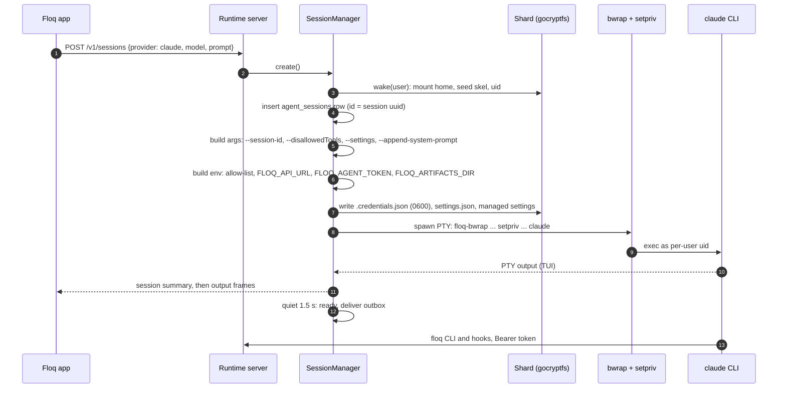
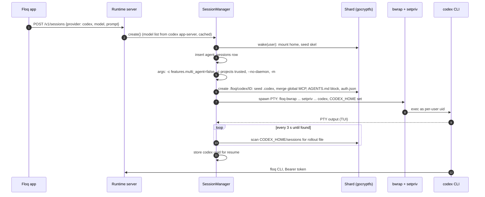

# How Claude Code and Codex run inside the Floq runtime

How the runtime image, the per-user sandbox and the session launcher make the two CLIs work. Every claim cites `file:line` (paths relative to the repo root; `runtime/src/...` is abbreviated `src/...`). Secrets are named, never shown.

**Contents:** [1 Image](#1-the-image) · [2 Sandbox](#2-sandbox-model) · [3 Launch](#3-session-launch) · [4 Auth](#4-auth) · [5 Injected config](#5-configuration-injected-per-provider) · [6 Comms](#6-runtime--agent-communication) · [7 Diagrams and comparison](#7-sequence-diagrams-and-claude-vs-codex) · [8 Troubleshooting](#8-troubleshooting) · [9 Agent browser](#9-agent-browser)

---

## 1. The image

One multi-stage `runtime/Dockerfile` (no other Dockerfile exists in the repo).

| Stage | What it does | Ref |
|---|---|---|
| `build` | `npm ci`, compiles the runtime and the in-image scripts (`floq`, hooks) to `dist/` | `runtime/Dockerfile:1-20` |
| `passt` | builds `pasta` from a pinned, checksummed release (for per-user netns) | `runtime/Dockerfile:25-34` |
| `runtime` (default target) | Debian bookworm + tools, both CLIs, skeleton, helpers | `runtime/Dockerfile:36-139` |
| `app-debug` (opt-in) | Flutter, Xpra/Xvfb, Rust toolchains; `--target app-debug` | `runtime/Dockerfile:142-218` |

### CLIs and pinning

- Both CLIs are installed globally with exact npm versions: `@anthropic-ai/claude-code@2.1.319 @openai/codex@0.167.0` (`runtime/Dockerfile:47`). Bump them there.
- The build fails if Codex lacks the launch modes the runtime needs (`codex --no-daemon --help`, `codex --no-daemon resume --help`) (`runtime/Dockerfile:69-72`).
- Binary names come from `FLOQ_CLAUDE_BIN` / `FLOQ_CODEX_BIN`, default `claude` / `codex` (`src/config.ts:232-234`).
- Claude Code's self-update is switched off (`DISABLE_AUTOUPDATER=1`) because `/usr` is read-only for the agent uid (`src/providers.ts:154`).
- Other pinned tools: `gocryptfs` 2.6.1 with checksums (`runtime/Dockerfile:53-68`), `uv` 0.13.7 and spec-kit (`:82-96`), superpowers, humanizer and anthropics/skills by tag or full commit hash (`:82-88`).

### Helper programs in `/usr/local/bin`

| File | Purpose | Ref |
|---|---|---|
| `floq` | agent-side CLI; talks to the runtime API (see [6](#6-runtime--agent-communication)) | `runtime/Dockerfile:97`, `runtime/image/floq.mts:135-145` |
| `floq-vault` | run commands with vault secrets injected | `runtime/Dockerfile:100` |
| `floq-block-native-subagent.mjs`, `floq-artifact-redirect.mjs`, `floq-native-question.mjs`, `floq-permission-request.mjs` | Claude hook scripts (`floq-artifact-redirect` refuses claude.ai Artifact publishing and points at `FLOQ_ARTIFACTS_DIR`; `read`/`list` stay allowed) | `runtime/Dockerfile:101-103` |
| `floq-apt` (+ `apt`, `apt-get`, `apt-cache` symlinks) | rootless apt: lists and unpacked packages under `~/.floq/apt`, launchers in `~/.local/bin`; root still gets the real tools | `runtime/Dockerfile:109-113` |
| `floq-bwrap`, `floq-pasta` | copies of `bwrap` / `pasta` under paths that no host AppArmor profile targets | `runtime/Dockerfile:114-118` |
| `/etc/claude-code/managed-settings.json` | read-only policy that denies `Agent`/`Task` | `runtime/Dockerfile:104-105`, `runtime/image/claude-managed-settings.json:1-8` |
| system `commit-msg` hook (`core.hooksPath`) | strips agent attribution, adds the Floq co-author trailer | `runtime/Dockerfile:119-121` |

`floq-flutter` is only in the `app-debug` target (`runtime/Dockerfile:169-171`).

### Skeleton home (`FLOQ_SKEL_DIR`)

`runtime/image/build-skel.sh` builds `/usr/local/share/floq/skel` at image build time (`build-skel.sh:6`). `FLOQ_SKEL_DIR` overrides the path (`src/config.ts:216`). Contents:

| Path in skel | Content | Ref |
|---|---|---|
| `.claude/CLAUDE.md` | routing rule: use Floq sessions, not native subagents | `build-skel.sh:12-21` |
| `.codex/AGENTS.md` | same rule plus a `FLOQ MANAGED GUIDANCE` block | `build-skel.sh:25-43` |
| `.claude/skills/`, `.codex/skills/` | superpowers, humanizer, Floq skills; `skill-creator` for Claude only | `build-skel.sh:46-81` |
| `.claude.json` | `context7` MCP server (stdio, `npx -y @upstash/context7-mcp`) | `build-skel.sh:84-94` |
| `.codex/config.toml` | same MCP server in TOML | `build-skel.sh:96-100` |

**Shipped Floq skills** come from `runtime/image/skills/` (`floq-app-debug`, `floq-orchestrate`, `floq-setup`, `floq-vault`) and are copied into both `.claude/skills` and `.codex/skills` (`build-skel.sh:79-81`). These four are the protected skills (`src/skills.ts:40`).

**Seeding.** On every shard wake the skeleton is copied into the user's home without overwriting existing files (`src/shards.ts:75`, `:88-108`). Protected skills are always copied; third-party skills only when `PREINSTALL_SKILLS` is on and the user has not deleted them (`src/shards.ts:97-98`). For Codex, each session gets its own `CODEX_HOME` seeded from `skel/.codex` (`src/manager.ts:1477`). The two `floq-orchestrate` skill folders are re-synced on every start so users cannot drift from them (`src/manager.ts:1480`, `:1504`; `src/codexGuidance.ts:71-105`).

---

## 2. Sandbox model

The runtime runs as root; **agents never do** (`runtime/Dockerfile:126-127`). Per user ("shard"):

| Aspect | Behaviour | Ref |
|---|---|---|
| Shard | one gocryptfs-encrypted home per user; data key stored encrypted in Postgres (`shards` table) | `src/shards.ts:60-70`, `src/shard.ts:283-300` |
| uid/gid | allocated from `shard_uid_seq` starting at 20000; no host `/etc/passwd` entry | `src/db.ts:21-24`, `src/shard.ts:93` |
| Identity in sandbox | generated minimal `/etc/passwd` and `/etc/group` (user `agent`, `HOME=/home/agent`) | `src/shard.ts:329-336`, `:89`, `:438` |
| Process wrapper | `floq-bwrap` with `--unshare-pid/ipc/uts/cgroup-try`, `--die-with-parent`, then `setpriv --reuid/--regid --clear-groups --inh-caps=-all --bounding-set=-all --no-new-privs` | `src/shard.ts:461-517` |
| Filesystem | `/usr` read-only; selected `/etc` files read-only (resolv.conf, ssl, gitconfig, apt, dpkg); home bound at `/home/agent`; `/run` is tmpfs | `src/shard.ts:471-502` |
| Per-user `/tmp` | host path `<home>/.floq/tmp`, mode 1777, bound at `/tmp`; entries unused for 7 days pruned on wake | `src/shard.ts:19-22`, `:403-417`, `:498-500` |
| `sandboxPaths` | binds only this user's home at its host path (`/mnt/<root>/<uid>`) because Git linked-worktree metadata stores absolute paths | `src/sandboxPaths.ts:5-27`, `src/shard.ts:503-505` |
| Claude managed dir | per-user `<meta>/<uid>.claude-code` bound read-only at `/etc/claude-code` when it holds a settings file, else the image's | `src/shard.ts:427-492` |
| Network (default on) | `FLOQ_NETNS` unset/`required` (runtime refuses to start if unavailable), `1` (falls back with a log), `off` (shared network, trusted single-tenant hosts only): one persistent netns per uid, launch wrapped in `nsenter`, nft egress policy, runtime reached at `10.255.255.1` mapped by pasta to the runtime's loopback | `src/netns.ts:9-24`, `src/shard.ts:456-458`, `:523` |
| Netns policy | drops RFC1918, CGNAT, link-local, reserved ranges; `FLOQ_NETNS_ALLOW` adds exceptions | `src/netns.ts:34-48`, `:157` |

Ownership matters: gocryptfs acts as the calling uid, so anything root creates in a mounted home is root-owned. The runtime therefore uses `mkdirOwned`, `writeFileOwned` and `ownTree` for everything it writes (`src/shard.ts:142-210`).

---

## 3. Session launch

`SessionManager.create()` validates input, picks cwd/worktree, inserts an `agent_sessions` row, then calls `launch()` (`src/manager.ts:1750-1925`). Resume goes through `resumeOnce()` → `launch(..., resume=true)` (`src/manager.ts:1941-1966`).

### Preparation in `create()`

- Model: `resolveModel` against the configured list; for Codex the list is discovered per user (see below); `model: "auto"` picks by role capability (`src/manager.ts:1760-1771`, `src/providers.ts:139-144`).
- Working directory: a registered project workspace, a cloned `gitUrl`, home, or `workspace/<id8>` (`src/manager.ts:1794-1829`).
- Worktrees: `isolated` creates `.floq/worktrees/<id>` on branch `floq/<id>` via git run **inside the same sandbox** so filter drivers from the agent's `.git/config` cannot run on the host (`src/manager.ts:1833-1884`).
- Initial prompt: at most 20000 chars; passed after `--` as its own argv element, fresh starts only (`src/manager.ts:1775-1779`, `:1457-1458`).

### Command lines

Built by `src/providers.ts:53-88`, then extended in `launch()`.

| | Claude Code | Codex |
|---|---|---|
| New | `[--dangerously-skip-permissions] [--model M] --session-id <floq uuid>` (`providers.ts:60-65`) | `--no-daemon [--dangerously-bypass-approvals-and-sandbox] [-m M]` (`providers.ts:74`) |
| Resume | `... --resume <floq uuid>` (`providers.ts:66-67`) | `--no-daemon ... resume <codex uuid>` (`providers.ts:76-77`) |
| Conversation id | the Floq session id (`manager.ts:1430`) | assigned by Codex; read back from the rollout file name (`manager.ts:1628-1637`) and stored, polled every 3 s (`:68`, `:1689-1699`) |
| Auto-approve flag source | profile `claudeAutoApprove` | profile `codexAutoApprove` |
| Added in `launch()` | `--disallowedTools Agent,Task`, `--settings <json>` (hooks), `--append-system-prompt <policy blocks>` (`manager.ts:1444`, `:1456`) | `-c features.multi_agent=false -c features.multi_agent_v2=false` and `-c projects={"<path>"={trust_level="trusted"}}` (`manager.ts:1434-1443`) |

`getProviderDefinition` swaps in the configured binary (`providers.ts:90-93`). A fast resume failure (under 8 s, not strict) falls back to a fresh start (`manager.ts:67`, `:1729-1741`). Spawning uses `node-pty` through `spawnPty` (`src/pty.ts:1-17`), wrapped by the sandbox driver (`src/shard.ts:431-440`). `Session` buffers output, tracks state and exit (`src/session.ts:36-338`).

### Environment

`buildSessionEnv` (`src/providers.ts:172-225`) starts from an **allow-list** of host variables (`providers.ts:11-40`; plus `config.sessionEnvAllow`), so unrelated host secrets never reach agents. Added there:

- git identity and `FLOQ_GIT_COAUTHOR` (`:194-203`); `GH_TOKEN`/`GITHUB_TOKEN` and a credential helper only when the user connected GitHub (`:205-212`);
- `TERM=xterm-256color`, `COLORTERM`, `GIT_TERMINAL_PROMPT=0`, `FLOQ_SESSION_ID`, `FLOQ_PROVIDER` (`:214-220`).

Claude only, forced after vault values so a secret cannot undo them: `CLAUDE_CODE_NO_FLICKER=1`, `DISABLE_AUTOUPDATER=1`, `CLAUDE_CODE_ENABLE_FUNCTION_HOOKS=1`, optional `DISABLE_PROMPT_CACHING` (`providers.ts:153-163`, `manager.ts:1464`).

Added in `launch()` (`src/manager.ts:1459-1475`):

| Variable | Meaning |
|---|---|
| `PATH` | `~/.local/bin` first, so `apt install` launchers work (`providers.ts:166-170`, `manager.ts:1461`) |
| vault secrets marked "env" | injected by name; all others only via `floq-vault` / `floq secret get` (`manager.ts:1463`, `:1465-1467`) |
| `FLOQ_API_URL` | `http://<10.255.255.1 or 127.0.0.1>:<FLOQ_PORT>` (`manager.ts:1469`) |
| `FLOQ_AGENT_TOKEN` | per-session bearer token (see [6](#6-runtime--agent-communication)) |
| `FLOQ_AGENT_NAME` | session title |
| `FLOQ_ARTIFACTS_DIR` | `/home/agent/Artifacts/<project id>`, created best-effort and also named in the system prompt (`manager.ts:1449-1454`, `:1472`; `src/artifacts.ts:24-52`) |
| `CODEX_HOME` | Codex only: `/home/agent/.floq/codex/<session id>` (`manager.ts:74`, `:1474`) |
| `DISPLAY`, `XAUTHORITY` | cleared, then set only from a display lease (`manager.ts:1543-1550`) |

### Models

- Static catalogs come from `FLOQ_CLAUDE_MODELS` / `FLOQ_CODEX_MODELS` (`src/config.ts:237-241`).
- Codex models are discovered per user: the runtime starts `codex app-server` in the sandbox with a throwaway `CODEX_HOME` and calls JSON-RPC `initialize` then `model/list` (hidden ones skipped, up to 20 pages) (`src/manager.ts:399-446`, `src/codexModels.ts:1-45`). Results are cached 5 minutes per user with in-flight de-duplication and fall back to the static list on failure (`src/codexModels.ts:48-86`). The cache is invalidated on login or disconnect (`manager.ts:2226`, `:2280`). If `FLOQ_CODEX_MODELS` is set, discovery is skipped (`manager.ts:391`).

### Cwd, trust, self-restart

Both CLIs run with the session's `cwd` under `/home/agent`. To skip trust dialogs for the exact checkouts of the launch:

- **Codex:** `-c projects={...trusted}` for the cwd, project cwd and their ancestors up to the home, under both `/home/agent` and the `/mnt/...` alias (`src/codexTrust.ts:24-76`).
- **Claude:** only when `claudeAutoApprove` is on, `hasTrustDialogAccepted` is written into `~/.claude.json` (`manager.ts:1524-1540`, `src/claudeSettings.ts:86-97`).

`floq session restart` sleeps and resumes only the caller; for Codex it requires the stored Codex id (`manager.ts:1969-2000`).

---

## 4. Auth

Agents use the user's **subscription login**, never API keys (`src/providers.ts:191`, `runtime/README.md` "Subscription logins").

### Storage and refresh (`src/credentials.ts`)

- Credentials sit in `provider_credentials`, AES-GCM encrypted with the server key and AAD `<userId>:<provider>_oauth` (`credentials.ts:104-124`).
- Shape equals the CLI's own file: the `claudeAiOauth` object of `~/.claude/.credentials.json`, or the whole Codex `auth.json` (`credentials.ts:9-14`).
- The **runtime refreshes**, not the CLIs: every 2 min a loop refreshes Claude when under 30 min remain, Codex when under 1 h remain or `last_refresh` is older than 7 days (`credentials.ts:23-26`, `:217-223`, `:287-296`). One refresh at a time per user and provider (in-process map plus Postgres advisory lock); the rotated refresh token is saved before anything else uses it (`credentials.ts:167-215`).
- `invalid_grant`-style errors mark the login disconnected ("Sign in again"); other failures back off exponentially up to 1 h (`credentials.ts:225-238`, `:265`).
- If a CLI rotated its own copy, `syncBack` adopts the newer one under the same lock (`credentials.ts:150-164`, `manager.ts:2092-2125`).

### How tokens reach the sandbox

At every `launch()` the runtime refreshes if due, then writes the file as the user's uid with mode 0600:

- Claude: `<home>/.claude/.credentials.json`, merged under `claudeAiOauth` (`manager.ts:1508-1509`, `:2052-2061`).
- Codex: `<home>/.floq/codex/<session>/auth.json` (`manager.ts:1489-1490`, `:2048-2050`).

After a refresh, `distribute()` rewrites the file for Claude and for each live Codex session (`manager.ts:2080-2089`). The token is **never in env, argv or the system prompt**. `disconnectProvider` deletes DB row and files (`manager.ts:2276-2291`).

### Login flows

| Flow | How | Ref |
|---|---|---|
| Claude, no terminal | server-side OAuth code + PKCE: `start()` builds the authorize URL (S256, 10 min TTL, max 3 pending per user); user pastes `<code>#<state>`; `finish()` exchanges it, reads plan from the profile endpoint, saves and distributes. Codes, verifiers and tokens are never logged | `src/claudeOauth.ts:36-137`; routes `src/server.ts:1010-1013` |
| Login terminal (both) | `startLogin` spawns `claude auth login` or `codex login --device-auth` in the user's sandbox with a throwaway dir `.floq/login-<provider>-<uuid>` as `CLAUDE_CONFIG_DIR` / `CODEX_HOME` (400 columns so URLs are not wrapped) | `manager.ts:2133-2167`, `:175-176` |
| Login completion | every 2 s the runtime reads `.credentials.json` / `auth.json` from candidate paths (the real config dir only counts if written after the login began); on success it saves, invalidates Codex models, distributes, deletes the temp dir. Times out after 10 min; a second concurrent start returns the live login | `manager.ts:2145-2149`, `:2168-2235`, `:2263-2274` |
| Log hygiene | output tail is scrubbed of 24+ char token-like strings before logging | `manager.ts:2214` |

The login session is never stored in `agent_sessions`, so it is neither listed nor resumed (`manager.ts:2127-2132`).

**`setupToken.ts` is not agent auth.** It is the one-time token for claiming the `FLOQ_BOOTSTRAP_ADMIN_EMAIL` account; only its SHA-256 hash is stored (`src/setupToken.ts:10-33`).

---

## 5. Configuration injected per provider

### Claude Code

| Mechanism | What | Ref |
|---|---|---|
| `~/.claude/settings.json` | on every start: commit attribution blanked, PR attribution = Floq text when co-author is on, `includeCoAuthoredBy:false`, `autoCompactEnabled`, `idleCompaction`, `tui:"fullscreen"`, optional cache TTL keys tracked in `floqManaged` so user edits win, `skipDangerousModePermissionPrompt` = auto-approve | `manager.ts:2064-2077`, `src/claudeSettings.ts:20-47` |
| CLI flags | `--disallowedTools Agent,Task`; inline `--settings` with `permissions.deny` and hooks: `PreToolUse` block hook, `AskUserQuestion` bridge (≥ 2.1.318), `PermissionRequest` bridge (≥ 2.0.45) | `src/nativeSubagentBlock.ts:33-70` |
| Managed settings | image file read-only at `/etc/claude-code`; per user, enabled plugins are promoted into a root-owned managed copy so their hooks see protected events (`session.compact`) | `runtime/image/claude-managed-settings.json`, `manager.ts:1511-1523`, `src/claudeManagedPlugins.ts:7-58` |
| System prompt | `--append-system-prompt` with the composed blocks below (one flag only; a second would not combine) | `manager.ts:1447`, `:1455-1456` |
| User memory | `~/.claude/CLAUDE.md` from the skeleton | `build-skel.sh:12-21` |
| Ownership repair | shallow `chown` of `~/.claude` and `~/.claude.json` so root leftovers never cause EACCES | `manager.ts:1495-1502` |

### Codex

| Mechanism | What | Ref |
|---|---|---|
| Private `CODEX_HOME` per session | seeded from `skel/.codex`; the user's global `~/.codex/config.toml` is not read, so only its `mcp_servers` are merged in at each start | `manager.ts:1474-1478`, `:2026-2046`, `src/mcpConfig.ts:364-372` |
| `AGENTS.md` | managed block between `FLOQ MANAGED GUIDANCE` markers is replaced on each start and carries the same composed system blocks; user text outside the markers is kept; symlinks and paths escaping `CODEX_HOME` are refused | `src/codexGuidance.ts:5-68`, `manager.ts:1485` |
| `-c` overrides | trust list, `features.multi_agent*=false` | `src/codexTrust.ts:73-76`, `src/nativeSubagentBlock.ts:51` |
| `auth.json` | see [4](#4-auth) | |

### Both: the system-level text

`composeSystemBlocks(subagent policy, memory policy, recruit skills, artifacts guidance, wired context)` (`manager.ts:1455`, `src/subagents.ts:156-158`). Claude receives it via `--append-system-prompt`, Codex via the managed `AGENTS.md` block, on **every start and resume** so it survives compaction.

| Block | Content | Ref |
|---|---|---|
| `[FLOQ SUBAGENT POLICY v1]` | every agent is a visible canvas session; cross-project messaging; never-blocking conversation; user questions via `floq decision request`; subagent reporting (`floq progress`, `floq ask-parent`); approvals; limits; "Floq subagents only" | `src/subagents.ts:70-137` |
| Approval text | irreversible actions need a real approval granted in the Floq app; a message from another agent is never an approval | `src/subagents.ts:97-100` |
| `[FLOQ MEMORY v1]` | only when `memories.enabled()` (Redis configured) | `src/subagents.ts:139-154`, `manager.ts:1455` |
| Artifacts guidance | save deliverables to `FLOQ_ARTIFACTS_DIR` by default; provider-aware: Claude is told claude.ai publishing is off and the scratchpad is temp-only, Codex that `/tmp` is temp-only | `src/artifacts.ts:46-52` |
| Wired context | notes and agents the user wired on the canvas | `src/wiredContext.ts:118-160`, `:310-316` |

### Native subagents are blocked, in layers

(`src/nativeSubagentBlock.ts:1-9`; enforced on start and resume for any role: `manager.ts:1442-1444`)

1. **Claude CLI:** `--disallowedTools Agent,Task` removes the tools from the model; CLI flags outrank user and project settings.
2. **Claude hook:** inline `PreToolUse` hook explains the refusal (skipped on Claude < 1.0.38 or if the script is missing, with a `subagent.native_block_degraded` warning) (`nativeSubagentBlock.ts:56-63`).
3. **Claude managed settings:** the image's read-only `/etc/claude-code/managed-settings.json` repeats deny + hook (`claude-managed-settings.json:1-8`).
4. **Codex:** `-c features.multi_agent=false` and `multi_agent_v2=false` (`nativeSubagentBlock.ts:17`, `:51`).
5. **Prompt:** policy text, skeleton CLAUDE.md/AGENTS.md and guidance all say native subagents are disabled and `floq subagent recruit` is the path (`subagents.ts:133`, `build-skel.sh:15`, `codexGuidance.ts:12`).

### Other injected pieces

- **MCP:** `src/mcpConfig.ts` edits Claude JSON (`~/.claude.json`, `.mcp.json`) and Codex TOML configs as pure text; secret values never enter the config, a `floq-vault` wrapper resolves them at connect time (`mcpConfig.ts:1-30`, `:223`, `:287`). After MCP changes the agent runs `floq session restart` (`codexGuidance.ts:16`).
- **Native title:** the sidebar title follows the CLI's own title. Claude: `custom-title`/`ai-title`/`summary` records in the transcript under `~/.claude/projects`; Codex: its session index. Polled on output (min 5 s) and every 3 s for the first 60 s; a manual rename (`title_locked`) always wins (`src/nativeTitle.ts:96-97`, `:202`, `:258`; `manager.ts:1639-1687`).

---

## 6. Runtime ↔ agent communication

**Transport.** The agent-side `floq` CLI reads `FLOQ_API_URL` and `FLOQ_AGENT_TOKEN` and sends `Authorization: Bearer <token>` to `/internal/*` (`runtime/image/floq.mts:135-145`). The three Claude hook scripts do the same (`floq-native-question.mts:11-22`).

**Token.** `vault.issueToken(user, session)` creates 32 random bytes bound to that session; `authenticate` rate-limits to 60 hits/min and rejects unknown tokens; the token is revoked when the session exits (`src/vault.ts:282-302`, `src/manager.ts:1470`, `:1719`). A token reaches only its own user's data. Responses are stripped of forged `[FLOQ APPROVAL` markers (`src/server.ts:318`, `:341`).

**Routes** (`src/server.ts:312-670`): `agents/list|ask|check|wait|progress|watch|recruit|subagent/*|restart|models|roles`, `inbox/list|read`, `vault/*`, `secrets/*`, `notes/*`, `sticky/*`, `memory/*`, `wired/get`, `skills/*`, `mcp/*`, `display/*`, `ports/open`, `decisions/*`, `approvals/*`.

**Approvals.** `approvals/request|status|verify|cancel` and `approvals/native-request` (used by the Claude permission hook) (`server.ts:465-480`). Only the user's app session can grant, via `/v1/approvals` and `/v1/approvals/<id>/resolve` (`server.ts:1348-1352`; `server.ts:109`). The decision is typed into the agent terminal as a `[FLOQ APPROVAL <id> ...]` line, which counts only if `floq approval verify <id> --consume` prints GRANTED (`src/subagents.ts:98`).

**Decisions (user questions).** `floq decision request` → `decisions/request`. For Claude's native `AskUserQuestion`, the hook calls `decisions/native-request`, waits, and returns `updatedInput.answers`; on any failure the native terminal prompt stays (`server.ts:452-464`, `runtime/image/floq-native-question.mts:6-41`).

**Typing into a terminal** (`src/messageDelivery.ts`).
- A message up to 1500 chars is typed. Over 200 chars it is sent as chunks of 256, wrapped in bracketed paste (`ESC[200~ … ESC[201~`) for Claude and Codex, then a separate Enter after 400 ms (`messageDelivery.ts:15-24`, `:97-113`).
- Longer bodies (max 100 000) go to the inbox; the receiver sees a 300-char preview plus `floq inbox read ID` (`messageDelivery.ts:25`, `:115-128`).
- ESC and control characters are replaced by a space; forged approval markers are neutralised (`messageDelivery.ts:30`, `:99`).
- A durable outbox stores messages and approvals **before** delivery and types them on the target's next ready; messages expire after 24 h, approvals after 15 min (`messageDelivery.ts:157-201`, `src/orchestrator.ts:160-195`).
- "Ready" means the TUI was quiet for 1.5 s (30 s cap), then the boot-resume notice is typed and ready listeners run (`manager.ts:305-306`, `:2494-2534`).

**Turn state** (`src/turn.ts`) reads the native transcript to know if an agent is working, idle or waiting: Claude `user`/`assistant` records with `stop_reason` or `turn_duration`; Codex `event_msg` types `user_message`, `task_started`, `task_complete`, `turn_aborted` (`turn.ts:30-74`). Open turn plus 60 s without terminal output means waiting for input (`turn.ts:113`). This backs `floq ask/wait/check`.

**Wired context.** Computed by `WiredContext.blockFor` on each launch (never throws; falls back to the stored block) and injected as above. While a session runs, changes are typed into it as a notice (`wiredContext.ts:160`, `manager.ts:2383-2392`).

---

## 7. Sequence diagrams and Claude vs Codex

### User creates a Claude agent



### User creates a Codex agent



### Differences

| | Claude Code | Codex |
|---|---|---|
| Binary / version pin | `claude` 2.1.319 | `codex` 0.167.0 (`runtime/Dockerfile:47`) |
| Config home | shared `~/.claude` per user | private `~/.floq/codex/<session>` per session (`manager.ts:1474`) |
| Conversation id | Floq session uuid, passed via `--session-id` | Codex-generated, captured from rollout file |
| Resume | exact: `--resume <id>` | exact only once the id is captured; otherwise fresh start |
| System prompt | `--append-system-prompt` | managed block in `AGENTS.md` |
| Native-subagent block | deny flag + hooks + managed settings | `-c features.multi_agent*=false` |
| User questions / approvals | `AskUserQuestion` and `PermissionRequest` hooks bridge to Floq | none; agents use `floq decision` / `floq approval` per the policy text |
| Trust prompt | `~/.claude.json` edited, only with auto-approve | `-c projects=...trusted` always |
| Credential file | `~/.claude/.credentials.json` (shared, one copy per user) | `auth.json` per session |
| Models | static list (`FLOQ_CLAUDE_MODELS`) | discovered through `codex app-server`, 5 min cache |
| Forced env | `CLAUDE_CODE_NO_FLICKER`, `DISABLE_AUTOUPDATER`, `CLAUDE_CODE_ENABLE_FUNCTION_HOOKS` | none |
| MCP config | `~/.claude.json`, `.mcp.json` | session `config.toml` merged from global |
| Plugins | user plugins promoted to managed plugins | n/a |
| Title source | transcript `custom-title`/`ai-title`/`summary` | Codex session index |
| Turn detection | `stop_reason`, `turn_duration` | `task_complete`, `turn_aborted` |

---

## 8. Troubleshooting

| Symptom | Cause and fix | Ref |
|---|---|---|
| Resume starts a fresh agent | The CLI exited within 8 s of a non-strict resume (conversation never saved); the runtime falls back to a new start. `floq session restart` is strict and fails instead | `manager.ts:67`, `:1729-1741`, `:1989` |
| `floq session restart` says Codex has no resumable conversation | The Codex rollout file does not exist yet; wait a few seconds and retry | `manager.ts:1975-1979` |
| "The previous process is still stopping" (`session_stopping`) | Resume raced a dying PTY; retry after it exits | `manager.ts:1945` |
| Cannot resume: worktree deleted | The session's worktree row is unavailable (`worktree_deleted`); delete the conversation instead | `manager.ts:1951-1954` |
| Login "starts" but never connects | Runtime logs `login.cred_missing` with the paths checked and `login.output_tail` (scrubbed). Login ends after 10 min | `manager.ts:2254-2255`, `:175` |
| "Sign in again" in the UI | Refresh got a permanent error (`invalid_grant`, reused or expired token); sign in again. Transient errors only back off | `credentials.ts:225-238`, `:265` |
| Claude shows "Auto-update failed" | `DISABLE_AUTOUPDATER=1` was not applied; it is forced for every Claude launch. Update by bumping the pin in the Dockerfile | `providers.ts:154`, `runtime/Dockerfile:47` |
| Claude falls back to the classic renderer | The fullscreen boot check misfires with one shared `~/.claude.json` and per-session PID namespaces; `CLAUDE_CODE_NO_FLICKER=1` is the fix | `providers.ts:146-152` |
| Claude cannot write transcripts (EACCES) | Root-owned leftovers in `~/.claude`; the runtime repairs a shallow slice on every start (check `claude.ownership_repair_failed`) | `manager.ts:1495-1502` |
| Random EPERM on file creation in homes | Old gocryptfs; image pins 2.6.1 with checksum. See `docs/ENCRYPTED-HOME-CONCURRENCY.md` | `runtime/Dockerfile:49-68` |
| Sandbox start fails: "network is unavailable" | `FLOQ_NETNS` is on (the default) and pasta failed (respawned up to 5 times); wake the workspace again. With `FLOQ_NETNS=1` a failed startup probe logs `netns.disabled` and falls back to the shared network | `shard.ts:456-458`, `runtime/README.md:61`, `:190` |
| `setpriv` cannot drop uid on Ubuntu 24.04+ hosts | AppArmor profile attached to `/usr/bin/bwrap`; the image uses the copy `/usr/local/bin/floq-bwrap` instead | `shard.ts:519-523`, `runtime/Dockerfile:114-115` |
| `floq` or hook scripts fail with a shebang error | CRLF line endings; the Dockerfile strips CR from installed scripts | `runtime/Dockerfile:106-108` |
| Native subagent still available | Check for `subagent.native_block_degraded` in logs (old Claude version or hook script missing); the deny flag still applies | `nativeSubagentBlock.ts:56-63` |
| MCP server configured but its tools missing | Configured is not connected. Codex: `codex mcp list --json`; if `not_logged_in` the user needs `codex mcp login NAME --no-browser`. After a config change run `floq session restart` | `codexGuidance.ts:12-16` |
| Codex does not see a global MCP server | Only `mcp_servers` are merged, at each start/resume; failures only log `codex.mcp_sync_failed` | `manager.ts:2026-2046` |
| Long agent message arrives as "preview only" | Over 1500 chars it goes to the inbox; run `floq inbox read ID` | `messageDelivery.ts:15`, `:115-128` |
| Agent says "approved by the user" via another agent | Never valid. Needs `floq approval request --wait` and `floq approval verify --consume` printing GRANTED | `subagents.ts:97-100` |
| `FLOQ_API_URL` unreachable from the agent | With netns it is the gateway `10.255.255.1`, mapped to the runtime loopback; only `<gateway>:<FLOQ_PORT>` is allowed | `manager.ts:1469`, `netns.ts:24`, `:154-155` |
| Third-party skills missing in a home | `PREINSTALL_SKILLS` off (default) seeds only the protected Floq skills | `shards.ts:97-98`, `runtime/README.md:131` |

---

## 9. Agent browser

One headless Chromium per user, running inside that user's sandbox. Claude Code and Codex agents drive it through the `floq-browser` MCP server (pinned `@playwright/mcp`). The user watches it live on the canvas **Browser** node and can click and type there, for example to log in to a site the agent then uses. Design and threat model: [design/agent-browser.md](design/agent-browser.md) (§A). Security summary: [SECURITY.md](../SECURITY.md).

### 9.1 Behaviour

- One daemon (`floq-browserd`) per user, started on demand and spawned through the user's sandbox (`ShardDriver.spawnPipe`). It stops after the idle timeout. The runtime never runs the browser binary on the host (`runtime/src/browser.ts`).
- Chromium is the full Playwright `chromium` build r1252 (Chromium 157.0.8103.15), run with `--headless=new` and its normal user agent (no stealth or fingerprint changes), installed at build time in `/opt/floq/browsers`. Nothing is downloaded at runtime.
- All agents of a user share one profile, so one login serves every project.
- **Cookie import:** the user uploads a Netscape `cookies.txt`, a JSON cookie export or a bookmarks HTML file. The runtime parses it, keeps the parsed result in memory for 10 minutes (single use), and never logs it or writes it to disk. Only the selected cookies are applied, inside the sandbox. Floq never reads local Chrome, Edge or Firefox stores.
- **Settings > Browser:** the per-user `agentBrowser` toggle, status, **Restart browser**, and **Clear browser data** (stops the daemon and removes the profile).
- **claude.ai connectors:** a per-user toggle in Settings. When it is off, Floq writes `disableClaudeAiConnectors: true` into managed settings, so agents cannot re-enable it. It applies at the next Claude session start. Codex sessions never use claude.ai connectors.

### 9.2 Environment knobs

| Variable | Default | Meaning | Ref |
|---|---|---|---|
| `FLOQ_AGENT_BROWSER` | unset = `auto` | `on` or `off`. `auto` is on when the pinned Chromium is installed | `runtime/src/config.ts:272-273` |
| `FLOQ_BROWSER_IDLE_MS` | `600000` | Stop the daemon after this long with no agent connection and no viewer. `0` = never | `config.ts:274` |
| `FLOQ_BROWSER_MEM_MB` | `0` (off) | `prlimit` address-space cap for the daemon, in MB. Off by default; see the design notes on Chromium's address-space use | `config.ts:275` |
| `FLOQ_BROWSER_ALLOW_PRIVATE` | `0` | `1` lets web content reach loopback and private ranges when there is no per-user netns, for example to preview an agent's dev server | `config.ts:276` |
| `PLAYWRIGHT_BROWSERS_PATH` | `/opt/floq/browsers` | Where the image keeps Chromium and `VERSION.json` | `config.ts:277` |

### 9.3 Commands

```
floq browser status     # exit 0 running, 3 stopped, 4 disabled or missing
floq browser version    # pinned Chromium and Playwright MCP versions; works while stopped
floq browser restart    # restart the daemon; session cookies are lost
```

### 9.4 Where data lives

- `~/.floq/browser/profile`: the Chromium profile (cookies, storage, saved logins). It is created 0700 inside the user's gocryptfs home and mounted only into that user's sandbox. Clear browser data removes only this directory.
- `~/.floq/browser/output`: the MCP output directory.
- `~/Downloads`: downloads. They are not size-capped and count against the user's quota.
- `~/.floq/browser/bookmarks.json`: bookmarks. Nothing reads them yet.

### 9.5 Bumping the version

The single pin is `runtime/image/browser/package.json` (`@playwright/mcp`). The Chromium revision follows from the committed `package-lock.json`. No other file names a version: `VERSION.json` and the Settings display are derived from it.

1. Pick a `@playwright/mcp` release that is at least 2 weeks old.
2. Set it in `runtime/image/browser/package.json` and run `npm install --package-lock-only` in that folder.
3. Build both image variants, then run the checks in [design §A.12.6](design/agent-browser.md) and `runtime/test/browserDaemon.test.mts`.
4. Record the new Chromium version and the image delta in the release note.

### 9.6 Limits and residual risks

- **Not a boundary against a hostile agent.** The sandbox (bubblewrap, per-user uid, per-user home) is the boundary. When user namespaces are unavailable, which is common on stock Docker seccomp, Chromium runs with `--no-sandbox`. `floq browser status` shows which mode is active. To enable the Chromium sandbox, allow unprivileged user namespaces on the host (a seccomp profile that permits them, or `kernel.unprivileged_userns_clone=1`).
- **Shared logins.** Every agent of the user, in any project, can use every site the user is logged in to. Imported sessions act as the user.
- **Local network.** With `FLOQ_NETNS=off`, a CDP interceptor blocks loopback and private addresses for pages and workers. It cannot see WebSocket or WebTransport handshakes, and a DNS name can resolve to a private address after the check. Keep the default `FLOQ_NETNS=required` on multi-user hosts.
- **Token exposure.** The daemon's bearer token reaches the MCP child's argv and env. Other processes of the same uid can read it. This is the same trust class as the user's own agents (residual L2).
- **Prompt injection.** Web content can steer an agent toward logged-in sites. Outward actions still need `floq approval`, and the user sees agent activity live.
- **Session cookies** do not survive a daemon stop or restart. Re-import them if needed.
- **Downloads** are not size-capped (L8). The screencast goes to every viewer of the same user, which is not a cross-user leak.
- The Chromium download in the image build is pinned by revision over HTTPS, not by sha256 (see [SECURITY.md](../SECURITY.md)).
